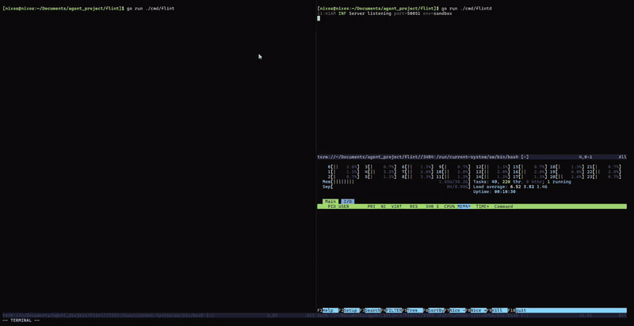

# flintD

Go gRPC server and CLI to trigger Firecracker microVMs locally. Can be packaged and installed
as daemons and CLI tools as well.

Images and builds defined with Nix for reproducibility and determinisim. 

## Demo - Clearer MP4 available within media folder



## Project Structure

* `cmd/flintd` — Background daemon running the gRPC server (`:50051`).
* `cmd/flint` — Interactive terminal dashboard (Bubble Tea) and operator CLI.
* `packaging/systemd/` — Systemd service definition for Linux deployments.
* `flake.nix` — Reproducible builds and declarative NixOS service module.
---
## How to Use (Simple Version)
```bash
# Optional but allow direnv to trigger nix when you enter this repo
direnv allow

# To create the nix development shell/environment
nix develop

# In one terminal window:
just run # OR go run ./cmd/flintd

# And in the other, the CLI tool
go run ./cmd/flint
```
Then on the screen select ORIGINAL or FIRECRACKER and input how many concurrent connections and/or requests you want (-c, -n respectively)
---

### Performance Benchmark - (100 clients, 100 gRPC requests + 100 microVMs)
```
 ╭────────────────────────────────────────────────────────────────────────────────────╮
 │                                                                                    │
 │                                 BENCHMARK RESULTS                                  │
 │                                                                                    │
 │  FIRECRACKER HOST RESOURCE SUMMARY                                                 │
 │                                                                                    │
 │  Local process totals sampled during the run                                       │
 │  CPU average              9.60 cores (40.0% host)                                  │
 │  CPU peak                 14.84 cores (61.8% host)                                 │
 │  Memory average           5857.7 MiB RSS                                           │
 │  Memory peak              7895.2 MiB RSS                                           │
 │  Processes average / peak 161.0 / 200                                              │
 │                                                                                    │
 │  Samples: 5 CPU • 6 memory                                                         │
 │                                                                                    │
 │  Summary:                                                                          │
 │    Count:    200                                                                   │
 │    Total:    5.73 s                                                                │
 │    Slowest:    5.73 s                                                              │
 │    Fastest:    3.86 s                                                              │
 │    Average:    5.32 s                                                              │
 │    Requests/sec:    34.91                                                          │
 │  Response time histogram:                                                          │
 │    3860.476 [1]  |                                                                 │
 │    4047.063 [1]  |                                                                 │
 │    4233.649 [1]  |                                                                 │
 │    4420.236 [6]  |∎∎∎                                                             │
 │    4606.823 [6]  |∎∎∎                                                             │
 │    4793.409 [11] |∎∎∎∎∎                                                          │
 │    4979.996 [12] |∎∎∎∎∎∎                                                         │
 │    5166.582 [14] |∎∎∎∎∎∎∎                                                       │
 │    5353.169 [30] |∎∎∎∎∎∎∎∎∎∎∎∎∎∎                                             │
 │    5539.756 [33] |∎∎∎∎∎∎∎∎∎∎∎∎∎∎∎∎                                          │
 │    5726.342 [85] |∎∎∎∎∎∎∎∎∎∎∎∎∎∎∎∎∎∎∎∎∎∎∎∎∎∎∎∎∎∎∎∎∎∎∎∎∎∎∎∎        │
 │  Latency distribution:                                                             │
 │    10 % in 4.74 s                                                                  │
 │    25 % in 5.15 s                                                                  │
 │    50 % in 5.47 s                                                                  │
 │    75 % in 5.62 s                                                                  │
 │    90 % in 5.68 s                                                                  │
 │                                                                                    │
 │                                                                                    │
 │  ↑/↓ or j/k: Scroll • PgUp/PgDn: Page • q/Esc: Back to form • Ctrl+C: Exit         │
 │                                                                                    │
 ╰────────────────────────────────────────────────────────────────────────────────────╯

```
---

## Installing the daemon + CLI as daemons and into /bin

### Option 1: NixOS (Recommended)

Add `flintD` to your system flake inputs and enable the service in your `configuration.nix`:

```nix
services.flintd = {
  enable = true;
};
````
This automatically builds the binaries, installs the cli into your $PATH, and manages the server daemon via systemd.

### Option 2: Linux Manual Installation
1.) Build and install binaries
```bash
go build -o /usr/local/bin/flintd ./cmd/flintd
sudo go build -o /usr/local/bin/flint ./cmd/flint
```
2.) Install and start systemd unit
```bash
sudo cp packaging/systemd/flintd.service /etc/systemd/system/
sudo systemctl daemon-reload
sudo systemctl enable --now flintd
```
3.) Check daemon status
```bash
systemctl status flintd
journalctl -u flintd -f
```


